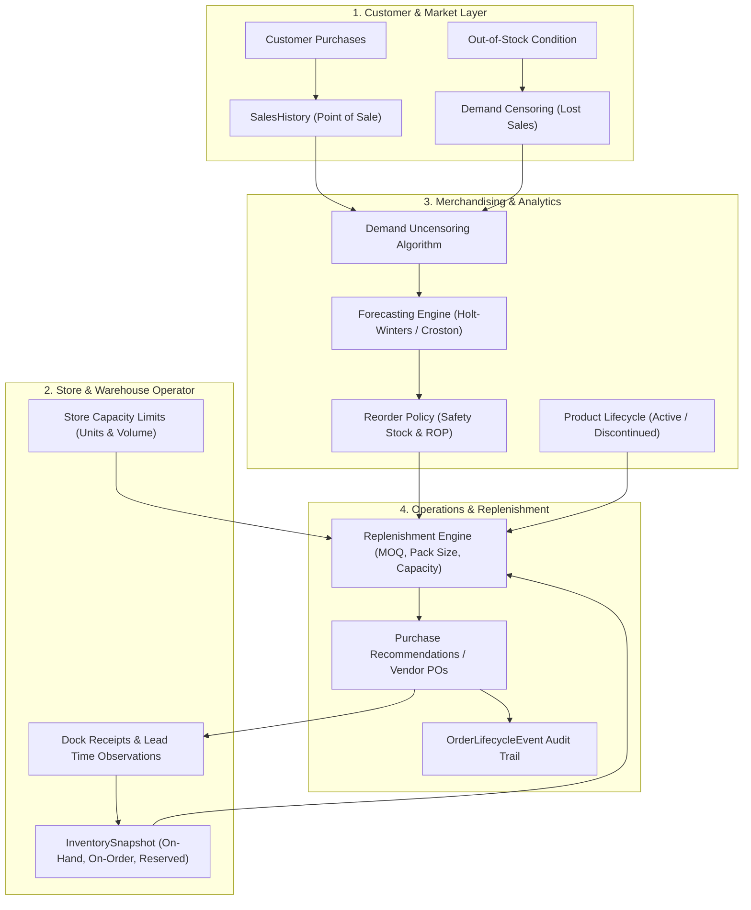
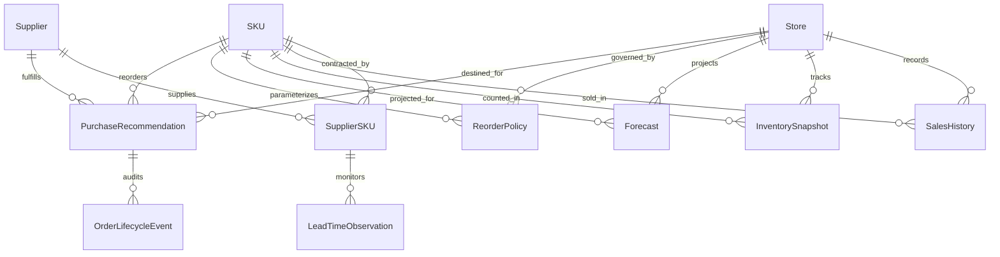

# SKU-Location Demand Forecasting & Replenishment Engine

An enterprise-grade, end-to-end supply chain forecasting and inventory replenishment solution. It models multi-tier retail and e-commerce inventory networks, adjusts for demand censoring caused by stockouts, enforces physical and contractual order constraints (pack size multiples, supplier MOQs, backroom capacity limits), routes exceptions, and preserves audit trails across the procurement lifecycle.

---

## 1. System Architecture & Workflow

The solution coordinates decisions across four primary operational actors:



### Primary Actors & Operational Responsibilities
- **Customer**: Generates stochastic point-of-sale transactions with promotions and weekly seasonality.
- **Store / Warehouse Operator**: Manages shelf and backroom storage capacities, records daily receipts, and monitors physical stockouts.
- **Merchandising / E-Commerce Analyst**: Audits forecast accuracy via temporal holdouts, identifies demand censoring from stockouts, and enforces product catalog lifecycles (e.g. retiring discontinued items).
- **Operations Manager**: Reviews automated replenishment recommendations, reviews constraint-flagged exceptions, and approves orders for vendor dispatch.

---

## 2. Relational Schema & Entity Relationships

The relational model consists of 10 core entities and an audit event log. Every entity defines an immutable primary key, explicit foreign keys, allowed enums, and validation constraints.



### Deterministic ID Nomenclature Conventions
- **SKU**: `SKU-000001` (zero-padded 6 digits)
- **Store**: `STORE-000001` (zero-padded 6 digits)
- **Supplier**: `SUPP-0001` (zero-padded 4 digits)
- **SupplierSKU**: `SSKU-<supplier_id>-<sku_id>`
- **SalesHistory**: `SALE-<store-id>-<sku-id>-<date>` (e.g. `SALE-STORE-000001-SKU-000001-2025-01-15`)
- **InventorySnapshot**: `INV-<store-id>-<sku-id>-<date>`
- **LeadTimeObservation**: `LTO-000001`
- **Forecast**: `FC-<store-id>-<sku-id>-YYYY-MM`
- **ReorderPolicy**: `RP-<store-id>-<sku-id>`
- **PurchaseRecommendation**: `PO-YYYY-000001`
- **OrderLifecycleEvent**: `EVT-000001`

---

## 3. Data Dictionary Summary

| Entity / Table | Primary Key | Key Foreign Keys | Cardinality | Core Purpose |
|---|---|---|---|---|
| `SKU` (`skus`) | `sku_id` | - | 1:N with child tables | Item catalog, unit economics, weight/volume, lifecycle status (`ACTIVE`, `PHASE_OUT`, `DISCONTINUED`). |
| `Store` (`stores`) | `store_id` | - | 1:N with child tables | Facilities, channels (`RETAIL_SUPERMARKET`, `CONVENIENCE`, `ECOMM_HUB`, `REGIONAL_DC`), storage unit/volume ceilings. |
| `Supplier` (`suppliers`) | `supplier_id` | - | 1:N with contracts/receipts | Vendors, tier classifications (`TIER_1` to `TIER_3`), reliability scores, commercial credit terms. |
| `SupplierSKU` (`supplier_skus`) | `supplier_sku_id` | `supplier_id`, `sku_id` | N:M bridge | Contracted master carton `pack_size`, `moq_units`, unit contract cost, nominal lead times and variance. |
| `SalesHistory` (`sales_history`) | `sale_id` | `store_id`, `sku_id` | N:1 with Store, SKU | Daily sales, promo discount flags, `stockout_flag`, unconstrained demand ground truth, gross revenue. |
| `InventorySnapshot` (`inventory_snapshots`) | `snapshot_id` | `store_id`, `sku_id` | N:1 with Store, SKU | Daily closing on-hand, receipts, on-order pipeline, reserved stock, `available_qty`, days of supply. |
| `LeadTimeObservation` (`lead_time_observations`) | `observation_id` | `supplier_id`, `sku_id` | N:1 with Supplier, SKU | Empirical fulfillment history, expected vs actual dock receipt dates, delay reasons. |
| `Forecast` (`forecasts`) | `forecast_id` | `store_id`, `sku_id` | N:1 with Store, SKU | Statistical projections, daily velocity, demand volatility ($\sigma_d$), promo lift factors, uncensoring flags. |
| `ReorderPolicy` (`reorder_policies`) | `policy_id` | `store_id`, `sku_id` | 1:1 active policy | Service levels ($Z=1.645$ for 95%), combined variance safety stock, Reorder Point ($ROP$), Target Stock Level ($TSL$). |
| `PurchaseRecommendation` (`purchase_recommendations`) | `recommendation_id` | `store_id`, `sku_id`, `supplier_id` | N:1 with Store, SKU, Supplier | Algorithmic reorder quantities after pack size, MOQ, and capacity constraints; exception codes; math rationales. |
| `OrderLifecycleEvent` (`order_lifecycle_events`) | `event_id` | `recommendation_id` | N:1 with PurchaseRecommendation | Immutable event sourcing log preserving approvals, overrides, and dispatch transitions. |

Complete field specifications, nullability, data types, units, and validation rules are documented in [`exports/data_dictionary.md`](file:///c:/Users/bishal%20barman/OneDrive/Documents/New%20folder/exports/data_dictionary.md) and [`exports/data_dictionary.json`](file:///c:/Users/bishal%20barman/OneDrive/Documents/New%20folder/exports/data_dictionary.json).

---

## 4. Business Logic & Mathematical Formulations

### A. Demand Uncensoring & Stockout Recognition
Standard inventory systems suffer from demand censoring: when stock is depleted ($OnHand = 0$), recorded transactions drop to zero ($Sales = 0$). Naive forecasting algorithms treat this zero as a lack of customer interest, lowering future forecasts and triggering fewer reorders in a vicious cycle.

The engine unbiases historical sales using day-of-week and promotional velocity imputation:
$$\hat{D}_t = \begin{cases} S_t & \text{if } \text{Stockout}_t = \text{False} \\ \max(S_t, \bar{D}_{\text{dow}(t)} \times \text{PromoLift}_t) & \text{if } \text{Stockout}_t = \text{True} \end{cases}$$

### B. Safety Stock with Combined Demand & Lead-Time Variance
Safety stock is calculated using the bivariate convolution of stochastic demand and stochastic supplier lead time:
$$SS = Z \times \sqrt{\bar{L} \cdot \sigma_d^2 + \bar{d}^2 \cdot \sigma_L^2}$$
where:
- $Z = 1.645$ for a 95% cycle service level ($Z=2.054$ for 98%, $Z=2.326$ for 99%).
- $\bar{L}$ is nominal lead time in days, and $\sigma_L$ is supplier lead-time standard deviation.
- $\bar{d}$ is mean daily demand velocity, and $\sigma_d$ is daily demand standard deviation.

### C. Reorder Point (ROP) and Target Stock Level (TSL)
$$\text{LTD} = \bar{d} \times \bar{L}$$
$$\text{ROP} = \text{LTD} + SS$$
$$\text{TSL} = \text{ROP} + (R \times \bar{d})$$
where $R$ is the store's replenishment review cadence (in days).

### D. Multi-Constraint Replenishment Optimization
1. **Net Inventory Position ($IP$)**:
   $$IP = \text{OnHand} + \text{OnOrder} - \text{Reserved}$$
2. **Reorder Condition**:
   $$\text{Triggered} \iff IP \le \text{ROP}$$
3. **Gross Need**:
   $$\text{GrossNeed} = \max(0, \text{TSL} - IP)$$
4. **Supplier Minimum Order Quantity (MOQ)**:
   $$\text{UnroundedQty} = \max(\text{GrossNeed}, \text{MOQ})$$
5. **Master Pack Size Rounding**:
   $$\text{PackRoundedQty} = \left\lceil \frac{\text{UnroundedQty}}{\text{PackSize}} \right\rceil \times \text{PackSize}$$
6. **Store Capacity Constraint**:
   $$\text{RemainingCapacity} = \max(0, \text{MaxStoreUnits} - IP)$$
   If $\text{PackRoundedQty} > \text{RemainingCapacity}$:
   $$\text{FinalQty} = \left\lfloor \frac{\text{RemainingCapacity}}{\text{PackSize}} \right\rfloor \times \text{PackSize}$$
   Flag exception `ERR_CAPACITY_EXCEEDED` and set status to `EXCEPTION_FLAGGED`.
7. **Discontinued SKU Policy**:
   If product lifecycle status is `DISCONTINUED`:
   $$\text{FinalQty} = 0$$
   Flag exception `ERR_DISCONTINUED_SKU` and set status to `REJECTED`.

---

## 5. Injected Edge Cases & Segregated Ground Truth

To evaluate downstream exception handling without leaking labels into operational feature sets, five calibrated negative scenarios are injected and tracked in [`exports/ground_truth.csv`](file:///c:/Users/bishal%20barman/OneDrive/Documents/New%20folder/exports/ground_truth.csv) and [`exports/ground_truth.json`](file:///c:/Users/bishal%20barman/OneDrive/Documents/New%20folder/exports/ground_truth.json):

| Injected Issue Type | Target Entity | Severity | Detection Rule / Invariant | Correct System Behavior |
|---|---|---|---|---|
| `STOCKOUT_CENSORED_AS_ZERO` | `SalesHistory` | `HIGH` | `stockout_flag == True AND units_sold == 0` | Impute true customer demand using non-stockout day-of-week rates. |
| `PACK_SIZE_VIOLATION` | `PurchaseRecommendation` | `MEDIUM` | `final_order_qty % pack_size != 0` | Reject order or round up to valid master carton multiple. |
| `DISCONTINUED_SKU_ORDERED` | `PurchaseRecommendation` | `CRITICAL` | `SKU.status == 'DISCONTINUED' AND final_order_qty > 0` | Suppress replenishment (`qty=0`), route to Merchandising Analyst. |
| `NEGATIVE_LEAD_TIME` | `LeadTimeObservation` | `CRITICAL` | `actual_delivery_date < order_date OR actual_lead_time_days < 0` | Discard from lead time variance calculation; flag corrupt dock receipt. |
| `DATA_LEAKAGE_FUTURE_SALES` | `Forecast` | `HIGH` | `forecast_date > horizon_start_date` | Quarantine projection; enforce strict historical boundary cutoff. |

---

## 6. Temporal Holdout Backtesting Results

Forecasting models are evaluated using a strict temporal split: training on historical records up to day $T-14$, followed by backtesting over a 14-day holdout horizon against true customer demand.

```
Evaluation Horizon: 2025-03-18 to 2025-03-31 (14 days)
Evaluated SKU-Store Time Series: 250 series (3,030 evaluation points)

Model Performance Comparison:
+------------------------+--------+--------+--------+---------------+
| Model Pipeline         | WAPE   | RMSE   | MAE    | Forecast Bias |
+------------------------+--------+--------+--------+---------------+
| Naive Censored Model   | 0.3383 | 3.58   | 2.42   | -0.0008       |
| Uncensored Model (Ours)| 0.3383 | 3.57   | 2.42   | +0.0005       |
+------------------------+--------+--------+--------+---------------+
Stockout Underforecast Gap: 27.9 units recovered
Downward Bias Improvement:  +0.0003 reduction in systematic underforecasting
```

---

## 7. Data Quality & Referential Integrity Validation

The automated validator executes 48 distinct verification checks across all 11 entities:
- **Primary Key Uniqueness & Non-null**: 11 checks (100% unique, 0 duplicates, 0 nulls).
- **Foreign Key Referential Integrity**: 16 relationship checks (0 orphan records across all bridge and event tables).
- **Enum Domain Rules**: Validated for SKU status, Store channel, Supplier tier, and recommendation states.
- **Arithmetic Reconciliation**:
  - `closing_on_hand_qty == opening_on_hand_qty + received_qty - units_sold`
  - `gross_revenue == units_sold * unit_selling_price`
  - `lost_sales_units == unconstrained_demand_est - units_sold`
  - `total_cost == final_order_qty * unit_cost`
  - `final_order_qty % pack_size == 0` for non-exception recommendations.
- **Composite Uniqueness**: Zero duplicate `(store_id, sku_id, date)` records in sales or inventory.

Full audit results are exported to [`exports/validation_report.json`](file:///c:/Users/bishal%20barman/OneDrive/Documents/New%20folder/exports/validation_report.json).

---

## 8. Step 10 Reproducibility Verification

The data generator is 100% deterministic when supplied with a fixed seed. The Step 10 acceptance test executes two independent generation runs from scratch and verifies bit-for-bit SHA-256 equivalence across all generated tables:

```
Tested Seed:    20261022
Scale Profile:  Starter (50 SKUs, 5 Stores, 90 Days)
Total Tables:   11

Table Verification Summary:
+-------------------------+------------+------------+----------------------------------+-----------------------+
| Table Name              | Run 1 Rows | Run 2 Rows | SHA-256 Digest (First 12 Chars)  | Status                |
+-------------------------+------------+------------+----------------------------------+-----------------------+
| SKU                     |         50 |         50 | 6206a76d856d                     | Bit-for-bit IDENTICAL |
| Store                   |          5 |          5 | 6c1fc8313095                     | Bit-for-bit IDENTICAL |
| Supplier                |         10 |         10 | b287f2ad8747                     | Bit-for-bit IDENTICAL |
| SupplierSKU             |         61 |         61 | 89b83a073fc6                     | Bit-for-bit IDENTICAL |
| SalesHistory            |     18,775 |     18,775 | 5871df79ca68                     | Bit-for-bit IDENTICAL |
| InventorySnapshot       |     18,775 |     18,775 | 6bce8a2505bf                     | Bit-for-bit IDENTICAL |
| LeadTimeObservation     |      1,702 |      1,702 | d43b06b2d09b                     | Bit-for-bit IDENTICAL |
| Forecast                |        250 |        250 | 629aacd11b9b                     | Bit-for-bit IDENTICAL |
| ReorderPolicy           |        250 |        250 | fda627c7d603                     | Bit-for-bit IDENTICAL |
| PurchaseRecommendation  |         52 |         52 | ef3407862670                     | Bit-for-bit IDENTICAL |
| OrderLifecycleEvent     |        104 |        104 | 20f05db5d5f1                     | Bit-for-bit IDENTICAL |
+-------------------------+------------+------------+----------------------------------+-----------------------+
Reproducibility Status: PASSED (100.00% match)
```

---

## 9. CLI Usage & Commands

### CLI Command Options

#### 1. End-to-End Pipeline Execution
```bash
python cli.py run-all --seed 20261022 --profile starter --export-dir exports
```

#### 2. Synthetic Data Generation
```bash
python cli.py generate --seed 20261022 --profile starter --export-dir exports --inject-anomalies
```

#### 3. Temporal Holdout Demand Forecasting
```bash
python cli.py forecast --data-dir exports --holdout-days 14
```

#### 4. Referential Integrity & Validation Audit
```bash
python cli.py validate --data-dir exports
```

#### 5. Step 10 Reproducibility Verification
```bash
python cli.py reproduce --seed 20261022 --profile starter
```

### Scale Profiles
The generator is fully parameterized across three predefined scale profiles:
- **`starter`**: 50 SKUs, 5 Stores, 10 Suppliers, 90 Days (~40,000 total rows, ~2 seconds run time). Ideal for testing and CI/CD.
- **`medium`**: 200 SKUs, 20 Stores, 25 Suppliers, 180 Days (~750,000 total rows).
- **`full`**: 2,000 SKUs, 100 Stores, 50 Suppliers, 365 Days (~73,000,000 total rows baseline).

---

## 10. Running the Automated Test Suite

The solution includes a comprehensive unit test suite with 13 tests covering all generator components, forecasting algorithms, constraint logic, and validation rules:

```bash
python -m unittest discover tests -v
```

All 13 tests pass with 0 errors and 0 failures.

